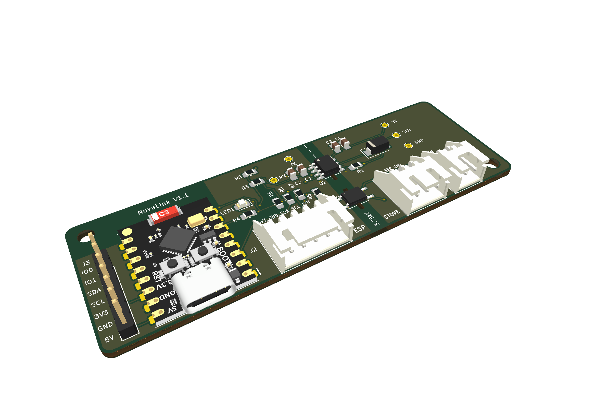

# NovaLink (prototype)

**Galvanically isolated ESP32-C3 interface for Micronova-controlled pellet stoves (NAVEL INSIDE port).**

NovaLink plugs into the 3-pin service port of a Micronova stove board (designed for X100 EVO "NAVEL INSIDE" connector,
+5 V / SER / GND, 19200 baud single-wire serial) and lets an ESP32-C3 SuperMini talk to the stove through a
3.75 kV digital isolator. The stove side is powered by the stove itself; the ESP side is powered by USB-C.
An optional VL53L0X time-of-flight sensor can be connected (for example to measure the pellet level).



> ℹ️ Early prototype design, never produced, kept for reference. The current design is on the
> [`main`](https://github.com/benbox69/novalink) branch.

> ⚠️ **Status: never built.** Both firmware
> versions run on a breadboard prototype connected to a Micronova X100 EVO (same protocol, same logic; only the pins
> and the signal inversion differ). Use at your own risk.
>
> This is a hobby project, not affiliated with or endorsed by Micronova. Opening a stove and connecting to its
> controller is at your own risk and may void the warranty.

## Compatibility

- **NAVEL INSIDE port** (3 pins: +5 V, SER, GND), e.g. Micronova X100 EVO: direct connection to J1.
- **SERIAL port** of other Micronova boards: should work too, through an adapter cable to J1
  (J1 pin 1 = +5 V, pin 2 = SER, pin 3 = GND). The firmware must then use the SERIAL port settings
  (usually 1200 baud, 8N2) instead of 19200 baud. Not tested yet.

> 🔴 **Never connect the 20 V line of the SERIAL port.** The SERIAL connector carries an extra supply line
> (about 15–20 V) next to +5 V, SER and GND. Only +5 V, SER and GND go to NovaLink: 20 V on J1 pin 1 would destroy
> the stove side of the board (the isolator supply is limited to 5.5 V, 6 V absolute maximum) and could damage the stove controller.
> Pin order differs between boards: identify each pin with a multimeter before wiring.

## Features

- **Isolation**: CA-IS3721HS digital isolator (Chipanalog), 3750 Vrms, 1 channel each way, fail-safe output high
  (if the ESP is unpowered, the stove line is left idle). 4 mm copper-free barrier with a 1 mm milled slot under the
  isolator. Separate grounds `GND_ESP` / `GND_STOVE`.
- **Stove line (SER)**: open-drain style transmit through an SS14 Schottky diode (the board only pulls SER low),
  receive through a 1 kΩ resistor. No TVS on SER on purpose: the line is only pulled up by ~38 kΩ inside the stove,
  extra capacitance would slow the edges.
- **ESP32-C3 SuperMini** (hand soldered), USB-C at the board edge.
- **ToF sensor connector** (JST XH 5 pins) with 2.2 kΩ I²C pull-ups and 100 Ω series resistors on the cable lines.
- **Extension header** (8 pins, 2.54 mm): GPIO0, GPIO1, GPIO3, I²C, 3V3, GND, 5V (USB).
- **Status LED** on GPIO10, test points for TX, RX, 5V, SER and GND.
- 79 × 30 mm, 2 layers, all SMD parts in 0805 / SOIC / SMA (hand-solderable).
- 3D-printable enclosure with captive M3 nuts, magnets and a snap-fit lid.

## Repository layout

| Path | Content |
|---|---|
| `NovaLink.kicad_*` | KiCad 10 project (schematic, PCB) |
| `libs/` | Project library: CA-IS3721HS and ESP32-C3 SuperMini symbols and footprints |
| `production/` | Manufacturing files: `NovaLink.zip` (Gerbers + drill), `bom.csv`, `positions.csv` |
| `docs/` | Schematic PDF, PCB renders, board STEP |
| `enclosure/` | Enclosure: `NovaLink_enclosure_base.stl`, `NovaLink_enclosure_lid.stl`, `NovaLink_enclosure.step` |
| `firmware/` | ESPHome configurations: `novalink.yaml` (micronova component fork), `novalink-lambda.yaml` (standalone) |

## Schematic

[docs/NovaLink_schematic.pdf](docs/NovaLink_schematic.pdf) — one A4 sheet, five blocks: ESP32-C3 SuperMini and LED,
isolation and stove connector, test points and mounting holes, ToF sensor, extension header.

### ESP32-C3 SuperMini pins

| Function | GPIO | Notes |
|---|---|---|
| TX to stove | GPIO5 | UART1 TX (GPIO21 is avoided: it prints the ROM boot log) |
| RX from stove | GPIO20 | UART1 RX |
| I²C SDA / SCL | GPIO6 / GPIO7 | shared between J2 and J3 |
| Sensor XSHUT | GPIO4 | |
| Status LED | GPIO10 | active high |
| On J3 only | GPIO0, GPIO1, GPIO3 | |
| Unused | GPIO2, GPIO8, GPIO9, GPIO21 | strapping / boot pins |

### Connectors

| Ref | Type | Pinout |
|---|---|---|
| J1 (stove) | JST XH 3 pins, right angle | 1 = +5V, 2 = SER, 3 = GND (stove side, isolated) |
| J2 (ToF sensor) | JST XH 5 pins, right angle | 1 = 3V3, 2 = GND, 3 = SDA, 4 = SCL, 5 = XSHUT |
| J3 (extension) | 1×8 pin header 2.54 mm | IO0, IO1, SDA, IO3, SCL, 3V3, GND, 5V (USB, not isolated) |

## Bill of materials

| Ref | Value | Package | LCSC |
|---|---|---|---|
| C1, C3 | 100 nF | 0805 | C49678 |
| C2, C4 | 1 µF | 0805 | C28323 |
| D1 | SS14 | SMA | C2480 |
| J1 | JST S3B-XH-A | XH 3P right angle | C157928 |
| J2 | JST S5B-XH-A | XH 5P right angle | C263757 |
| J3 | Pin header 1×8 | 2.54 mm | C492407 |
| LED1 | Red | 0805 | C84256 |
| R1, R4 | 1 kΩ | 0805 | C17513 |
| R2, R3 | 2.2 kΩ | 0805 | C17520 |
| R5, R6, R7 | 100 Ω | 0805 | C17408 |
| U2 | CA-IS3721HS | SOIC-8 | C428884 |
| U1 | ESP32-C3 SuperMini (U.FL version recommended) | module | — (hand soldered) |

## Enclosure

Ready-to-print files: `enclosure/NovaLink_enclosure_base.stl` and `enclosure/NovaLink_enclosure_lid.stl`;
`enclosure/NovaLink_enclosure.step` to adapt it in any CAD tool.

- Outside 84 × 35 × 22 mm, openings for USB-C, J1, J2 and a slot above J3.
- Board held by two M3 × 10 screws into captive M3 nuts under the base (no inserts).
- 4 pockets for Ø10 × 3 mm magnets to stick the box to the back of the stove.
- Snap-fit lid, removable with a flat screwdriver (notch at the front).
- Print in **PETG or ASA**, not PLA (the back of a stove gets warm).

## Firmware

Two ESPHome configurations are available in `firmware/`. Both compile with ESPHome 2026.10.2, use the same pins and
the same Home Assistant API. Pick one:

| | `novalink.yaml` | `novalink-lambda.yaml` |
|---|---|---|
| Protocol handled by | ESPHome `micronova` component, from a fork | Lambdas in the YAML file, no external component |
| Status | Running on a breadboard prototype since 2026-11-15 | Ran on a breadboard prototype from 2026-11-14 to 2026-11-15 |
| Entities | Room and fumes temperature, stove state, power, fan speed, setpoint, power level, on/off switch | Same, plus raw fan speed, minutes before brazier cleaning and the text shown on the stove display |
| Safety | Standard component behaviour | Refuses writes to RAM 0x58, at most one EEPROM write every 5 s, on/off only from a matching state |
| Best for | Following ESPHome and the upcoming pull request | A self-contained file with every detail visible and editable |

Both files need a `secrets.yaml` with `wifi_ssid`, `wifi_password`, `novalink_api_key`, `ota_password` and
`fallback_password`. Memory addresses were checked on a Micronova X100 EVO; other boards may use other addresses.

> ⚠️ On the X100 EVO, never write to RAM address 0x58: it raises the "fumes probe" alarm. Do not add a custom button or
> write action on that address.

### Option 1: ESPHome micronova component (fork)

The `micronova` component shipped with ESPHome only accepts 1200 baud 8N2 and needs an `enable_rx_pin`.
The fork [benbox69/esphome](https://github.com/benbox69/esphome) adds what NovaLink needs, without changing existing
configurations:

- `enable_rx_pin` is optional;
- any baud rate and stop bits (8 data bits, no parity), so the 19200 baud NAVEL INSIDE port works;
- `echo: true` reads back and checks the bytes the board sends on the single-wire line before the stove reply.

```yaml
external_components:
  - source: github://benbox69/esphome@micronova-navel-2026.10
    components: [micronova]

uart:
  id: stove_uart
  tx_pin: GPIO5
  rx_pin: GPIO20
  baud_rate: 19200

micronova:
  uart_id: stove_uart
  echo: true
```

Branch `micronova-navel-2026.10` matches ESPHome 2026.10.x. Branch `micronova-navel` follows the ESPHome `dev` branch
and is the base of a pull request to ESPHome, planned once the boards have been tested.

### Option 2: standalone firmware (lambdas)

`novalink-lambda.yaml` handles the Micronova protocol itself in a few lambdas: one request every 150 ms, echo skipped,
checksum verified, writes queued before reads. It needs nothing but ESPHome, and it also reads the 16-character text
shown on the stove display.

### Hardware notes

No pin inversion is needed (the isolator and the diode keep the logic levels). The line is single-wire: the board
always receives its own bytes, both configurations deal with it. 19200 baud is for the NAVEL INSIDE port; the SERIAL
port usually uses 1200 baud, 8N2 (see Compatibility).

### Planned: MQTT firmware

A firmware publishing over MQTT is planned, so that NovaLink can be used with any home automation system, not only
with ESPHome and Home Assistant.

## 3D model of the SuperMini

The ESP32-C3 SuperMini 3D model is not included. Download it (CC0) from
[Printables – ESP32 C3 Super mini model by Josselin Hefti](https://printables.com/model/1360390-esp32-c3-super-mini-model)
and save the STEP file as `libs/3d/ESP32-C3-SuperMini.step`; the footprint already points to it.

## License

NovaLink (hardware design, enclosure and documentation) is licensed under
[Creative Commons Attribution-NonCommercial-ShareAlike 4.0](https://creativecommons.org/licenses/by-nc-sa/4.0/)
(CC BY-NC-SA 4.0): you may build, modify and share it for non-commercial purposes, with attribution and under the
same license. Commercial use or sale is not permitted.
